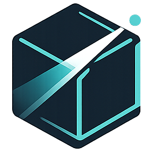
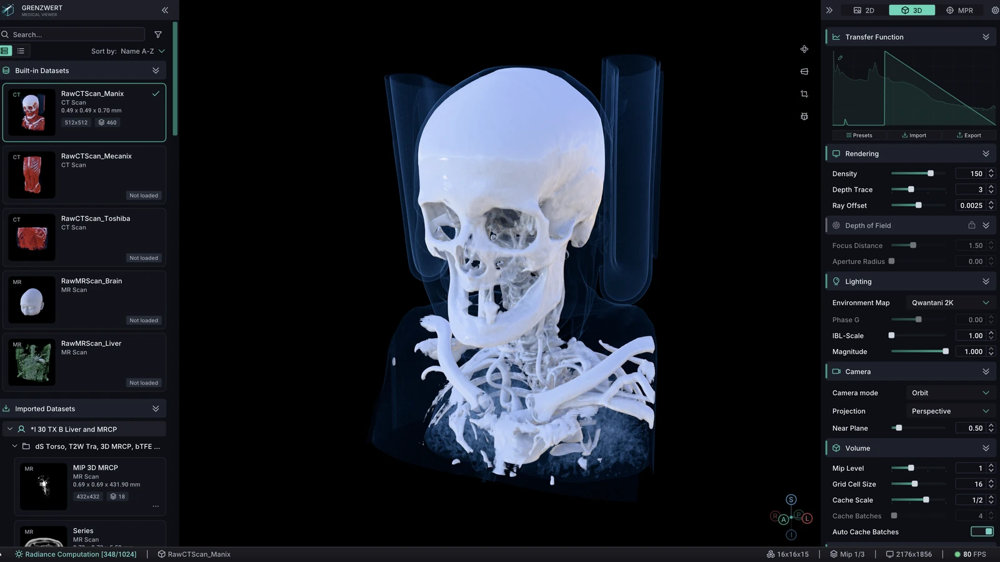
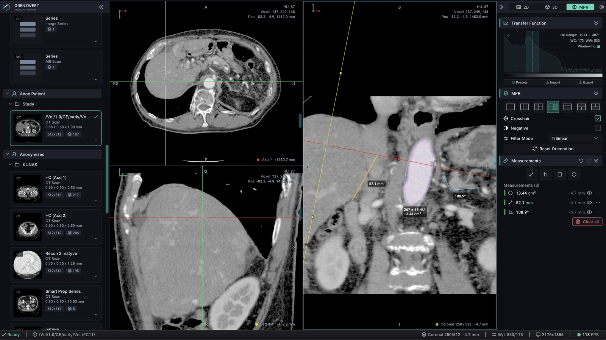
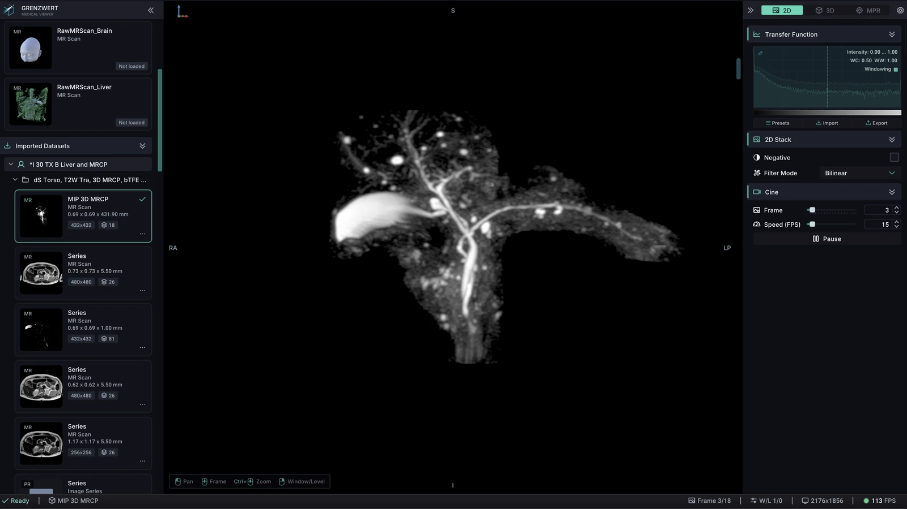
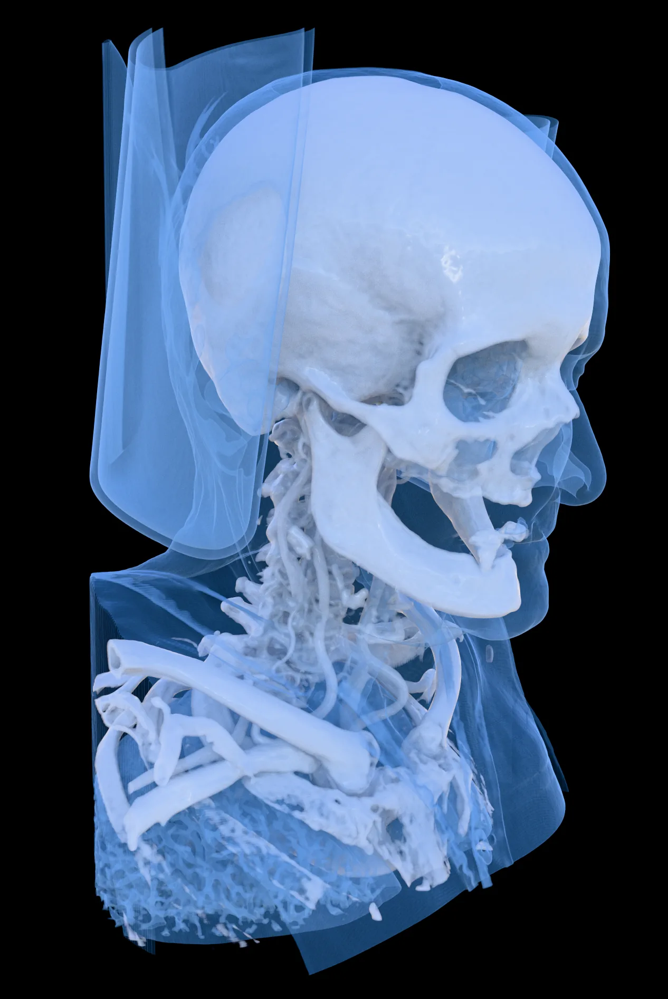
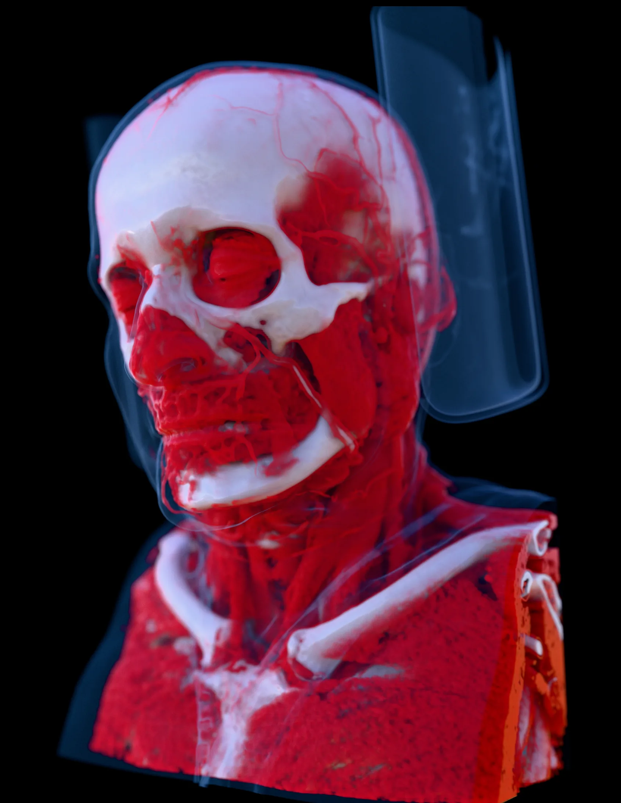
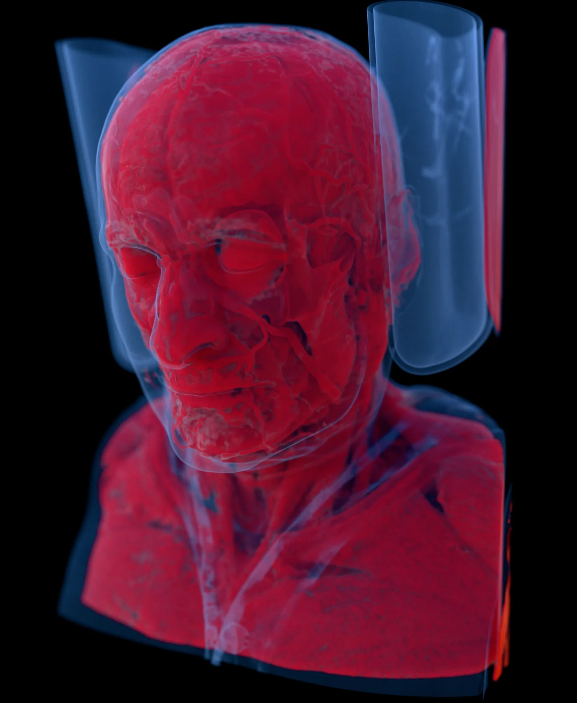
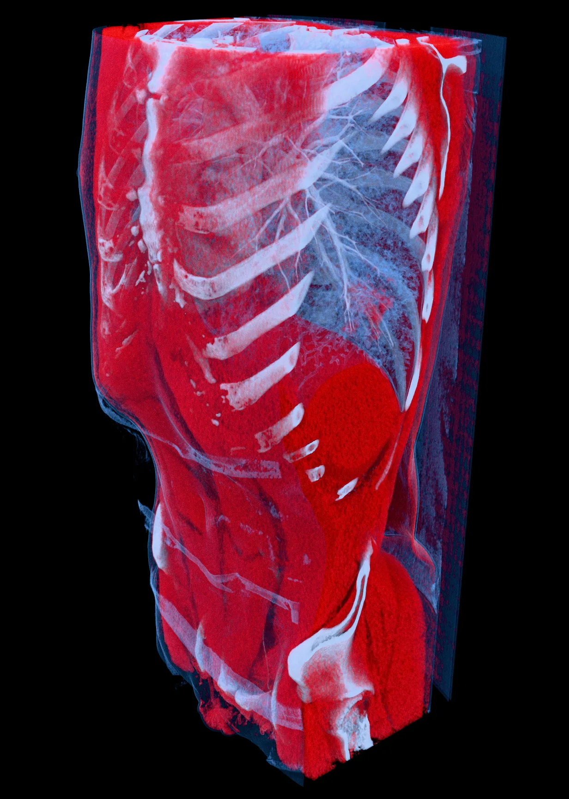

<h1> Grenzwert</h1>

DICOM viewer with cinematic 3D rendering in your browser.

Try the [demo with sample CT and MRI data](https://grenzwert.net/demo/) or visit [grenzwert.net](https://grenzwert.net/).

The **free demo** runs with built-in CT and MRI datasets, without an account or installation. **Pro** adds local import of compatible DICOM files and folders: selected files are processed on your device and are not uploaded to a Grenzwert server. Requires WebGPU and a compatible desktop browser; see [browser requirements](https://grenzwert.net/en/#compatibility).

## Features

- **3D volume rendering** with physically based lighting, tissue presets, and editable color, opacity, and material properties.
- **Multiplanar reconstruction (MPR)** with linked axial, coronal, and sagittal views, a shared crosshair, and Window/Level controls.
- **Measurements** for distances, angles, and rectangular or elliptical regions, including area and intensity statistics.
- **2D stack and cine** for frame-by-frame navigation and playback.
- **Volume cropping** to isolate a region of interest.
- **Local DICOM import in Pro**, with a series browser and metadata inspection.

Built with C++, WebAssembly, and WebGPU, using [Diligent Engine](https://github.com/DiligentGraphics/DiligentEngine), [Emscripten](https://emscripten.org/), and [GDCM](https://github.com/malaterre/GDCM).

<table>
  <tr>
    <th width="50%">MPR and measurements</th>
    <th width="50%">2D stack and cine</th>
  </tr>
  <tr>
    <td></td>
    <td></td>
  </tr>
</table>

## Gallery

MANIX and MECANIX CT datasets rendered in Grenzwert. Click an image to view it at full size.

<table>
  <tr>
    <td width="50%" align="center"> Bone preset</td>
    <td width="50%" align="center"> Bone and soft tissue</td>
  </tr>
  <tr>
    <td align="center"> Transparent tissue</td>
    <td align="center"> Lungs and ribs</td>
  </tr>
</table>

## Feedback

This is Grenzwert’s public issue tracker. The application and website source code are private.

You can [report a bug](https://github.com/grenzwert-net/Grenzwert/issues/new?template=bug_report.yml), [request a feature](https://github.com/grenzwert-net/Grenzwert/issues/new?template=feature_request.yml), or [ask a question](https://github.com/grenzwert-net/Grenzwert/issues/new?template=question.yml).

Search [existing issues](https://github.com/grenzwert-net/Grenzwert/issues?q=is%3Aissue) before opening a report. Include reproduction steps; for viewer problems, browser, OS, and GPU details also help. **Issues are public: do not attach patient data, private DICOM files, or credentials.**

For account or billing help, email [support@grenzwert.net](mailto:support@grenzwert.net). Report vulnerabilities [privately](SECURITY.md).

Created by [Mikhail Gorobets](https://github.com/MikhailGorobets). Proprietary software; [Terms of Service](https://grenzwert.net/en/terms/).

For research, education, and demonstration. Not intended for diagnosis or clinical decision-making.
